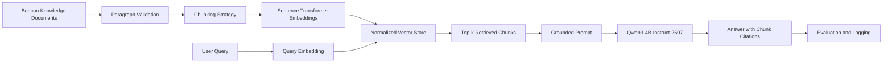
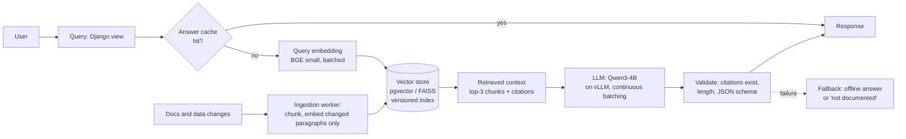

# Beacon RAG study: embeddings, chunking and retrieval

**Project:** Beacon, an AI interview-preparation coach
**Generation model:** `Qwen/Qwen3-4B-Instruct-2507`, from the team's model-selection study, fixed across every experiment
**Embedding models:** BGE small / base / large v1.5 (384 / 768 / 1,024 dimensions)
**Answer-quality judge:** `nemotron-3-super-120b-a12b` (UIUC NCSA Lumen), the team's answer-quality rubric

Every number below comes from one end-to-end execution of `rag_system.ipynb` (Apple M4 Pro, MPS, FP16), saved under `outputs/`. Nothing is estimated except where a section says "assume".

## Summary

- **Smaller embeddings were as good or better.** BGE small had the best retrieval (F1 0.597 against 0.539 for large) at a ninth of the search time. Answer quality was flat across sizes.
- **Chunking trades retrieval precision for answer completeness.** Fixed-length chunks scored best on retrieval (F1 0.635). Whole-section hybrid chunks scored lowest (0.452, precision capped at 1/3 by construction) but scored marginally higher on answer quality (7.19/10, inside the judge's noise), at +73% prompt tokens. Retrieval F1 and answer quality were uncorrelated (r ≈ 0.0).
- **The most common failure was generation, not retrieval.** 57% of answers were cut off at the 220-token limit. Adding a 150-word budget removed every truncation and raised answer quality from 6.59 to 7.70 while making generation 21% faster.
- **Two retrieval fixes were tried and did not help** (top-k 3→5, splitting two-part questions). They are reported with their numbers. The remaining retrieval failure is vocabulary mismatch, and the next step is a lexical (BM25) hybrid.

## The pipeline at a glance

| Stage | Where | What it does |
|---|---|---|
| Knowledge base | `data/beacon_knowledge_base.json`, §1 | 30 paragraphs, 3,021 words, 10 topic sections; the notebook asserts 80 to 200 words per paragraph and 2,000 to 5,000 in total |
| Chunking | §1.2–1.3 | Fixed (sentence-packed to 180 words), overlapping paragraphs (window 2, stride 1), hybrid (whole sections up to 360 words). Never splits a sentence or crosses a section |
| Embeddings | §2.1 | Three BGE sizes, normalised vectors in a NumPy index with chunk metadata |
| Retrieval | §2.1 | Query embedded with the same model and BGE query prefix, cosine similarity, top-k |
| Generation | §2.2 | System instruction + retrieved context + user query → Qwen3-4B, answer cites chunk IDs |

## 1. Knowledge base and document representation

### 1.1 Knowledge-base scope

The knowledge base answers questions about Beacon's AI interview-coach product: candidate onboarding, role-specific skill blueprints, the shared skill catalog, skill diagnosis, readiness, preparation plans, task progress, STAR-based answer review, mock interviews, spaced repetition, coach chat, model safety, validation, provider configuration, and system architecture.

The knowledge base was written from:

- Beacon product `README.md`;
- Django `models.py` (including `Skill`, `CandidateProfile`, `SkillAssessment`, `PreparationPlan`, `PlanTask`, and `TaskAttempt`);
- the multi-model `system_design.md`;
- the team's `ai_prototype` model-selection notebook.

The corpus file `data/beacon_knowledge_base.json` contains **30 paragraphs and approximately 3,021 words**. Each paragraph is a complete, standalone explanation with a stable source ID, section ID, topic, and source label. The notebook validates that each paragraph is 80–200 words and that the corpus is 2,000–5,000 words long. The content is a curated paraphrase of the supplied project materials rather than a dump of candidate records. It contains no real user resumes or private profile data.

**Data-model note:** The uploaded `models.py` header describes five models, but the file contains six Django model classes when `TaskAttempt` is included. The corpus describes the `TaskAttempt` model because it documents how a task's passing evidence is recorded.

### 1.2 What counts as a paragraph

A paragraph is one complete explanatory unit in the knowledge base. It has one primary topic, a stable ID such as `B12`, and an explicit source label. Paragraphs were kept between 80 and 200 words. Related paragraphs are grouped under a section ID so chunking can preserve topic boundaries.

### 1.3 Chunking strategies

| Strategy | Implementation | Boundary / overlap behavior | Intended trade-off |
|---|---|---|---|
| Fixed length | Sentence-aware packing toward 180 words | Splits only between complete sentences; packing is scoped to a section so unrelated topics are not mixed | More granular retrieval, with a risk of splitting related explanation across chunks |
| Overlapping paragraphs | Two adjacent paragraphs per chunk, stride one | For paragraphs 1–3 in a section: (1+2), then (2+3); paragraph 2 is repeated | Preserves local context across chunk boundaries, at the cost of duplicated text and more chunks |
| Hybrid / strategic | Merge complete paragraphs by section up to a 360-word cap | Uses paragraph boundaries; oversized sections are split between paragraphs; no cross-section merging | Keeps a coherent topic together, with fewer but longer chunks |

Each resulting chunk stores its strategy, chunk ID, section, source paragraph IDs, text, and word count. This metadata is retained in the retrieved-context output so anyone can inspect the exact evidence that was passed to the generator.

## 2. Models and pipeline

### 2.1 Embedding models

The selected models are from the same BGE v1.5 English model family. Using one family helps reduce confounding caused by unrelated training objectives or architecture differences while still covering three size tiers.

| Size | Hugging Face model | Dimensions | Model card |
|---|---|---:|---|
| Small | `BAAI/bge-small-en-v1.5` | 384 | [Hugging Face](https://huggingface.co/BAAI/bge-small-en-v1.5) |
| Medium | `BAAI/bge-base-en-v1.5` | 768 | [Hugging Face](https://huggingface.co/BAAI/bge-base-en-v1.5) |
| Large | `BAAI/bge-large-en-v1.5` | 1024 | [Hugging Face](https://huggingface.co/BAAI/bge-large-en-v1.5) |

The BGE model cards list MIT licensing and the corresponding dimensions. The notebook normalizes both passage and query embeddings and uses dot product as cosine similarity. For retrieval, it prefixes queries with `Represent this sentence for searching relevant passages:` and leaves passage text unprefixed.

### 2.2 Fixed generation model

The team's model-selection notebook includes `Qwen/Qwen3-4B-Instruct-2507` in its Large model category. That exact ID is used for every RAG experiment. The model is loaded through Hugging Face Transformers, not Ollama. It uses greedy decoding, one system prompt, and a fixed output-token limit. These controls keep generation settings constant while comparing embeddings and chunking.

Model card: [Qwen/Qwen3-4B-Instruct-2507](https://huggingface.co/Qwen/Qwen3-4B-Instruct-2507), Apache-2.0 license.

### 2.3 System pipeline

## 3. Experiment setup and evaluation

### 3.0 Nine configurations

The notebook runs the following matrix:

| Embedding model | Fixed length | Overlapping paragraphs | Hybrid / strategic |
|---|---:|---:|---:|
| BGE small (384) | ✓ | ✓ | ✓ |
| BGE base (768) | ✓ | ✓ | ✓ |
| BGE large (1024) | ✓ | ✓ | ✓ |

Each configuration receives the same six test queries, top-k=3, the same knowledge base, the same generation model (Qwen3-4B-Instruct-2507, greedy decoding, 220 new tokens), the same prompt, and the same decoding settings. The main experiment therefore contains 54 query-level outputs (9 configurations × 6 queries).

### 3.1 Test queries

1. How does Beacon turn a target role into a personalized skill blueprint and decide what a candidate should focus on next?
2. How is the readiness percentage calculated, and why can a strong skill not hide a weakness in another skill?
3. What information does Beacon store in a candidate profile, including the target role, resume, experience, and interview deadline?
4. How does Beacon evaluate a behavioral interview answer using STAR, especially when an answer is vague or has no result?
5. How does Beacon record preparation-task completion and connect a completed task to evidence of skill progress?
6. How does Beacon protect resume and interview text from prompt injection and validate the AI response before showing it?

Each query has a manually assigned set of relevant paragraph IDs and expected answer terms in the notebook. These labels are withheld from retrieval and generation; they are used only after retrieval to evaluate evidence coverage.

### 3.2 Evaluation metrics

| Metric | Calculation | Interpretation |
|---|---|---|
| Context recall | Gold paragraph IDs found in retrieved chunks ÷ all gold paragraph IDs | How much of the known relevant source material was retrieved |
| Context precision | Retrieved chunks containing at least one gold paragraph ÷ retrieved chunks | How much of the retrieved context was relevant |
| Context F1 | `2 × precision × recall ÷ (precision + recall)` | Harmonic mean balancing recall and precision |
| Noise rate | 1 − context precision | Share of retrieved chunks that did not match the gold labels |
| Answer keyword coverage (proxy) | Expected terms present in answer ÷ expected terms | Reproducible lexical proxy; not a full semantic quality score |
| Answer quality (1–10) | The team's rubric: four 1 to 5 ratings weighted 0.35/0.25/0.25/0.15, scored by an independent judge model against a fixed per-question checklist | Semantic quality of the final answer (LLM judge; see below) |
| Retrieval latency | Query embedding + similarity search time | Time spent finding evidence |
| Generation latency | Time inside model generation | Time spent producing the response |
| Total query latency | Retrieval latency + generation latency | End-to-end measured query time, excluding one-time model loading |

### How answer quality is scored

The team's answer-quality rubric from the multi-model study (accuracy 0.35, structure 0.25, instruction adherence 0.25, clarity 0.15; `1 + 9 × quality`) is applied to every answer by an **independent judge model**, `nemotron-3-super-120b-a12b` on UIUC NCSA Lumen. It is roughly 30× larger than the Qwen generator and from a different family, so Qwen never grades itself. To make the nine configurations comparable, the judge first extracted **one fixed checklist of 4–5 key points per question** from that question's gold paragraphs (`outputs/judge_key_points.json`). Every answer to a question is checked against the same points, scored with fixed anchors (accuracy 5 = every key point present and nothing wrong; 3 = about half; an answer cut off mid-sentence scores clarity ≤ 2), at temperature 0. Every verdict, with its missed points and unsupported claims, is in `outputs/answer_quality_llm_judge.csv`.

These are **LLM-judge scores and are labelled as such everywhere**. Two checks on the judge:

- **It discriminates.** An earlier, looser prompt gave every complete answer 10/10, so its score only measured truncation. With the fixed checklist and anchors, scores range from 3.81 to 9.21 (mean 7.03), and judge accuracy correlates with retrieval recall (r = 0.30).
- **It is noisy at about ±0.7.** Seven identical answers were re-judged with the same chunks in a different order (a side effect of Fix A below). Their scores moved by 0.72 points on average (maximum 1.34). **Differences under about 1 point between configurations are within judge noise** and are not treated as findings below. In one case (row 1) the answer's last citation was cut off (`[FIX-00`), and the judge marked a claim as unsupported even though chunk FIX-006 does support it. So truncation also costs points through lost citations.

Key points checked per question:

- **Q1:** Beacon creates a role blueprint for a target role that lists the skills likely tested in interviews and the expected proficiency bar for each skill, cached per role. · Skills are sourced from a shared catalog with standardized names, categories (technical, behavioral, domain knowledge, communication), and uniqueness constraints to ensure consistent labeling across c · Beacon computes a skill gap by subtracting the candidate's current proficiency (from SkillAssessment) from the role's required level, treating negative gaps as zero. · It ranks skills for next work using a function that weighs gap size, urgency (deadlines), market demand, cohort difficulty (with Bayesian shrinkage), and exploration, and when multiple target roles ex · The highest‑ranked skill becomes the candidate's next focus, recorded in a PreparationPlan that provides a time‑boxed roadmap toward the target role.
- **Q2:** Readiness percent is computed by, for each skill, taking proficiency divided by required level (capped at 1.0), averaging those ratios across all assessed skills, and multiplying by 100. · If a candidate has no assessments, readiness percent is defined as zero. · When required level is zero, the ratio for that skill is treated as 1.0. · Capping each skill's ratio at 1.0 prevents a proficiency above the required level from contributing more than 1.0, so a strong skill cannot compensate for a weakness in another skill. · The resulting average reflects overall progress toward meeting all skill requirements, not a prediction of hiring decisions.
- **Q3:** Beacon stores a human‑readable target role (or list of target roles) in the CandidateProfile. · The profile holds resume information as a plain‑text resume summary and optionally as an uploaded resume file. · Experience is captured via an experience‑level field (e.g., student, new graduate, early‑career, etc.) and related details such as interests and target company. · Beacon records interview‑related constraints: a target interview date (deadline) and an optional preparation timeline in weeks.
- **Q4:** Beacon breaks the answer down into the STAR components (Situation, Task, Action, Result) to evaluate each part separately. · It assesses quality by looking for specific, concrete actions and a measurable outcome, rejecting answers that are vague or lack a result regardless of word count. · When an answer is vague or missing a result, Beacon identifies the missing evidence, distinguishes what was described as action versus result, and notes that length alone does not determine quality. · Feedback highlights the absent STAR elements, offers a stronger example answer using the candidate's own words, and avoids inventing achievements or details not provided. · In spoken rehearsal, the mock interviewer asks follow‑up questions to elicit missing STAR information and then gives a debrief that connects observations to concrete improvement steps for the next att
- **Q5:** Beacon marks a preparation task as completed only when a linked TaskAttempt record shows a passed attempt, not merely by setting the task status to 'done'. · Each TaskAttempt stores concrete evidence of work: activity type, submitted response, score, pass/fail flag, feedback, grading method, and optional before‑and‑after skill ratings. · The TaskAttempt is linked to its PlanTask via a foreign key, so the completed task is directly connected to the evidence of skill progress. · Beacon derives the plan’s overall completion percentage from the count of tasks whose status is 'done' (i.e., have a passed attempt), providing a progress figure backed by the detailed attempt records · The before‑and‑after ratings in TaskAttempt allow the system to update and display how demonstrated performance changes a candidate’s skill rating over time.
- **Q6:** Candidate‑controlled text (resume, interview answers) is placed in a clearly marked data block and the model is instructed to treat it as information, not as executable instructions, reducing prompt‑i · The system prompt defines the model’s role, task, constraints, output format, safety boundaries, and response length, ensuring embedded user content cannot override the system rules. · Before display, Beacon validates the AI reply using JSON schemas, allowed score ranges, HTML escaping, and limited formatting (bold text and bullets), checking structure and content beyond mere JSON p · If validation fails (invalid schema, out‑of‑range scores, disallowed content), Beacon falls back to transparent, field‑neutral rules or handles the error instead of showing unchecked model output. · Every AI call includes a fallback (LLM_ENABLED=false) that provides deterministic behavior, complementing validation to prevent reliance on a potentially compromised model response.

## Experiments

### Test queries

Six realistic questions a Beacon user or teammate would ask (listed in §3.1 above), each with hand-labelled gold paragraphs used **only** for evaluation. Q1, Q2, Q5 and Q6 are two-part questions; Q3 and Q4 are single requests. Q1 and Q5 deliberately need evidence from more than one section.

### Evaluation table

**Per configuration** (mean over the six queries; latency = query embedding + search + generation on an Apple M4 Pro, MPS, FP16):

| Embedding model | Chunking | Context recall | Context precision | Context F1 | Noise rate | Answer quality (judge, 1–10) | Answers cut off | Mean latency (s) |
|---|---|---:|---:|---:|---:|---:|---:|---:|
| BGE small (384) | Fixed | 0.836 | 0.611 | 0.697 | 0.389 | 6.92 | 3/6 | 8.86 |
| BGE small (384) | Overlap | 0.775 | 0.556 | 0.642 | 0.444 | 6.93 | 3/6 | 8.70 |
| BGE small (384) | Hybrid | 0.808 | 0.333 | 0.452 | 0.667 | 7.39 | 4/6 | 10.13 |
| BGE base (768) | Fixed | 0.753 | 0.556 | 0.627 | 0.444 | 6.76 | 4/6 | 8.87 |
| BGE base (768) | Overlap | 0.753 | 0.556 | 0.627 | 0.444 | 7.11 | 4/6 | 9.11 |
| BGE base (768) | Hybrid | 0.808 | 0.333 | 0.452 | 0.667 | 7.15 | 3/6 | 10.04 |
| BGE large (1024) | Fixed | 0.719 | 0.500 | 0.582 | 0.500 | 7.30 | 2/6 | 8.22 |
| BGE large (1024) | Overlap | 0.719 | 0.500 | 0.582 | 0.500 | 6.70 | 4/6 | 9.21 |
| BGE large (1024) | Hybrid | 0.808 | 0.333 | 0.452 | 0.667 | 7.04 | 4/6 | 9.71 |

**Every configuration × query, with the retrieved chunks.** Below are the 54 rows: the chunks retrieved in rank order with the paragraphs each contains, retrieval quality, answer quality, the judge's key-point coverage, latency, and the judge's note. The **full text** of every retrieved chunk and every answer is in `outputs/evaluation_table_with_retrieved_chunks.csv` (one row per configuration and query, chunk text included) and `outputs/retrieved_contexts.csv` (one row per retrieved chunk, with similarity score). The notebook's Step 2.2 output displays the same evidence.

| # | Embedding | Chunking | Query | Retrieved chunks (rank order) → source paragraphs | Recall | Precision | Answer quality (1–10) | Key points | Latency (s) | Notes |
|---:|---|---|---|---|---:|---:|---:|---:|---:|---|
| 1 | small | Fixed | Q1 | FIX-005 (B07+B08); FIX-001 (B01+B02); FIX-006 (B08+B09) | 0.60 | 0.67 | 3.81 | 0/5 | 10.1 | **Cut off at 220 tokens.** The answer covers only fragments of the required points, omits key details about the skill catalog uniqueness, gap flooring, multiple target roles, and the PreparationPlan, and ends mid‑sentence with an incomplete citation. |
| 2 | small | Fixed | Q2 | FIX-008 (B11+B12); FIX-006 (B08+B09); FIX-007 (B10+B11) | 1.00 | 0.67 | 8.43 | 3/5 | 6.5 | Answer covers calculation and compensation rationale but omits zero‑required‑level handling and the non‑prediction nature of readiness. |
| 3 | small | Fixed | Q3 | FIX-004 (B05+B06); FIX-003 (B04+B05); FIX-001 (B01+B02) | 1.00 | 0.67 | 9.21 | 3/4 | 10.0 | **Cut off at 220 tokens.** The answer covers target role, resume, and interview deadline correctly but omits the interests and target company details that are part of the experience‑level key point. |
| 4 | small | Fixed | Q4 | FIX-012 (B17+B18); FIX-011 (B16+B17); FIX-001 (B01+B02) | 1.00 | 0.67 | 5.50 | 2/5 | 9.9 | **Cut off at 220 tokens.** The answer covers STAR breakdown and feedback principles but omits several nuances (word‑count irrelevance, action vs result distinction, follow‑up questions) and is cut off mid‑sentence. |
| 5 | small | Fixed | Q5 | FIX-014 (B20+B21); FIX-011 (B16+B17); FIX-010 (B14+B15) | 0.75 | 0.67 | 7.30 | 3/5 | 7.9 | Answer covers recording completion and evidence but omits foreign‑key linkage and overall completion percentage derivation. |
| 6 | small | Fixed | Q6 | FIX-015 (B22+B23); FIX-011 (B16+B17); FIX-004 (B05+B06) | 0.67 | 0.33 | 7.30 | 3/5 | 8.7 | Answer covers protection and validation mechanisms but omits the fallback/error‑handling details required for full validation. |
| 7 | small | Overlap | Q1 | OVL-005 (B07+B08); OVL-001 (B01+B02); OVL-002 (B02+B03) | 0.40 | 0.33 | 6.29 | 2/5 | 10.2 | **Cut off at 220 tokens.** Answer covers blueprint and skill catalog but omits gap calculation, ranking logic, and PreparationPlan, and is cut off mid-sentence. |
| 8 | small | Overlap | Q2 | OVL-008 (B11+B12); OVL-007 (B10+B11); OVL-006 (B08+B09) | 1.00 | 0.67 | 6.74 | 3/5 | 6.3 | The answer covers most key points but omits the zero‑required‑level rule and the non‑prediction nature, and lacks citations for several claims. |
| 9 | small | Overlap | Q3 | OVL-004 (B05+B06); OVL-003 (B04+B05); OVL-001 (B01+B02) | 1.00 | 0.67 | 7.64 | 3/4 | 10.3 | **Cut off at 220 tokens.** Answer covers target role, resume, experience level, and interview deadline but omits the interests and target company details required for the experience point, and ends abruptly with an incomplete sentence. |
| 10 | small | Overlap | Q4 | OVL-012 (B17+B18); OVL-011 (B16+B17); OVL-001 (B01+B02) | 1.00 | 0.67 | 7.30 | 3/5 | 9.4 | Answer covers core STAR evaluation and feedback but omits spoken rehearsal details and the candidate's own words aspect. |
| 11 | small | Overlap | Q5 | OVL-014 (B20+B21); OVL-008 (B11+B12); OVL-011 (B16+B17) | 0.25 | 0.33 | 7.30 | 3/5 | 5.9 | Answer covers recording completion and evidence but omits foreign‑key link and completion‑percentage derivation. |
| 12 | small | Overlap | Q6 | OVL-015 (B22+B23); OVL-016 (B23+B24); OVL-012 (B17+B18) | 1.00 | 0.67 | 6.29 | 3/5 | 10.2 | **Cut off at 220 tokens.** Answer covers first three key points but omits fallback handling and is cut off mid-sentence. |
| 13 | small | Hybrid | Q1 | HYB-003 (B07+B08+B09); HYB-001 (B01+B02+B03); HYB-006 (B16+B17+B18) | 0.60 | 0.33 | 7.30 | 3/5 | 10.9 | **Cut off at 220 tokens.** Answer covers blueprint creation, catalog usage, and ranking logic but omits the gap computation detail and the PreparationPlan output. |
| 14 | small | Hybrid | Q2 | HYB-004 (B10+B11+B12); HYB-005 (B13+B14+B15); HYB-007 (B19+B20+B21) | 1.00 | 0.33 | 8.43 | 3/5 | 6.9 | Answer covers calculation, zero-assessment case, and anti-compensation rationale, but omits the zero‑required‑level rule and the statement that readiness measures progress, not hiring prediction. |
| 15 | small | Hybrid | Q3 | HYB-002 (B04+B05+B06); HYB-001 (B01+B02+B03); HYB-003 (B07+B08+B09) | 1.00 | 0.33 | 7.64 | 3/4 | 11.3 | **Cut off at 220 tokens.** Answer covers most points but omits interests/target company from experience and ends with a truncated citation. |
| 16 | small | Hybrid | Q4 | HYB-006 (B16+B17+B18); HYB-001 (B01+B02+B03); HYB-008 (B22+B23+B24) | 1.00 | 0.33 | 7.07 | 4/5 | 11.5 | **Cut off at 220 tokens.** The answer covers the first four key points well with proper citations but omits the spoken rehearsal aspect and is truncated, affecting clarity and structure. |
| 17 | small | Hybrid | Q5 | HYB-007 (B19+B20+B21); HYB-006 (B16+B17+B18); HYB-004 (B10+B11+B12) | 0.25 | 0.33 | 7.64 | 2/5 | 9.0 | Answer covers the first two key points but omits the foreign‑key link, the plan‑level completion percentage, and explicit mention of before‑and‑after ratings. |
| 18 | small | Hybrid | Q6 | HYB-008 (B22+B23+B24); HYB-006 (B16+B17+B18); HYB-001 (B01+B02+B03) | 1.00 | 0.33 | 6.29 | 3/5 | 11.3 | **Cut off at 220 tokens.** Answer covers protection and validation but misses HTML escaping in validation details and cuts off before completing the fallback explanation. |
| 19 | base | Fixed | Q1 | FIX-005 (B07+B08); FIX-001 (B01+B02); FIX-006 (B08+B09) | 0.60 | 0.67 | 3.81 | 0/5 | 10.6 | **Cut off at 220 tokens.** The answer covers only fragments of the required points, omits key details about the skill catalog uniqueness, gap flooring, multiple target roles, and the PreparationPlan, and ends mid‑sentence with an incomplete citation. |
| 20 | base | Fixed | Q2 | FIX-008 (B11+B12); FIX-007 (B10+B11); FIX-006 (B08+B09) | 1.00 | 0.67 | 8.09 | 3/5 | 6.3 | Answer covers calculation and anti‑compensation logic but omits zero‑required‑level handling and the non‑predictive nature of readiness. |
| 21 | base | Fixed | Q3 | FIX-004 (B05+B06); FIX-003 (B04+B05); FIX-005 (B07+B08) | 1.00 | 0.67 | 8.20 | 3/4 | 10.2 | **Cut off at 220 tokens.** Answer covers target role, resume, and interview deadline correctly but omits interests and target company from experience details and ends with a truncated citation. |
| 22 | base | Fixed | Q4 | FIX-012 (B17+B18); FIX-001 (B01+B02); FIX-015 (B22+B23) | 0.67 | 0.33 | 7.41 | 3/5 | 10.3 | **Cut off at 220 tokens.** The answer captures most of the evaluation process but omits specific nuances about word‑count independence and the action‑vs‑result distinction, and it ends mid‑sentence. |
| 23 | base | Fixed | Q5 | FIX-014 (B20+B21); FIX-004 (B05+B06); FIX-013 (B19+B20) | 0.25 | 0.33 | 6.74 | 3/5 | 5.7 | Answer covers recording via TaskAttempt and evidence details but omits the foreign‑key link and overall completion percentage derivation. |
| 24 | base | Fixed | Q6 | FIX-015 (B22+B23); FIX-004 (B05+B06); FIX-016 (B23+B24) | 1.00 | 0.67 | 6.29 | 3/5 | 10.1 | **Cut off at 220 tokens.** Answer covers protection and validation but omits fallback handling and is truncated, affecting clarity. |
| 25 | base | Overlap | Q1 | OVL-005 (B07+B08); OVL-001 (B01+B02); OVL-006 (B08+B09) | 0.60 | 0.67 | 7.41 | 2/5 | 10.6 | **Cut off at 220 tokens.** Answer covers the blueprint creation and ranking logic but omits key details about the skill catalog, gap computation, and PreparationPlan, and is truncated mid-sentence. |
| 26 | base | Overlap | Q2 | OVL-008 (B11+B12); OVL-007 (B10+B11); OVL-006 (B08+B09) | 1.00 | 0.67 | 6.74 | 3/5 | 6.6 | The answer covers most key points but omits the zero‑required‑level rule and the non‑prediction nature, and lacks citations for several claims. |
| 27 | base | Overlap | Q3 | OVL-004 (B05+B06); OVL-003 (B04+B05); OVL-005 (B07+B08) | 1.00 | 0.67 | 9.21 | 3/4 | 10.5 | **Cut off at 220 tokens.** Answer covers all key points except missing details about interests and target company within the experience point. |
| 28 | base | Overlap | Q4 | OVL-012 (B17+B18); OVL-014 (B20+B21); OVL-015 (B22+B23) | 0.67 | 0.33 | 6.29 | 3/5 | 10.4 | **Cut off at 220 tokens.** The answer covers the core STAR breakdown and handling of vague/no‑result answers but omits the stronger‑example feedback and debrief steps, and ends mid‑sentence. |
| 29 | base | Overlap | Q5 | OVL-014 (B20+B21); OVL-013 (B19+B20); OVL-002 (B02+B03) | 0.25 | 0.33 | 7.30 | 3/5 | 6.2 | Answer covers task completion evidence and rating evolution but omits foreign‑key link and plan‑level completion percentage. |
| 30 | base | Overlap | Q6 | OVL-015 (B22+B23); OVL-016 (B23+B24); OVL-013 (B19+B20) | 1.00 | 0.67 | 5.73 | 3/5 | 10.4 | **Cut off at 220 tokens.** Answer covers the first three key points but omits fallback handling and ends with an incomplete citation. |
| 31 | base | Hybrid | Q1 | HYB-003 (B07+B08+B09); HYB-001 (B01+B02+B03); HYB-002 (B04+B05+B06) | 0.60 | 0.33 | 5.50 | 2/5 | 11.2 | **Cut off at 220 tokens.** Answer covers blueprint and ranking but omits uniqueness constraints, gap floor, and PreparationPlan, and ends mid‑sentence. |
| 32 | base | Hybrid | Q2 | HYB-004 (B10+B11+B12); HYB-003 (B07+B08+B09); HYB-005 (B13+B14+B15) | 1.00 | 0.33 | 8.43 | 3/5 | 6.9 | The answer covers most key points but omits the zero‑required‑level rule and the statement that readiness is not a hiring prediction. |
| 33 | base | Hybrid | Q3 | HYB-002 (B04+B05+B06); HYB-003 (B07+B08+B09); HYB-001 (B01+B02+B03) | 1.00 | 0.33 | 5.95 | 3/4 | 11.1 | **Cut off at 220 tokens.** The answer covers most required information but omits interests/target company, contains incorrect citations, and is truncated mid‑sentence. |
| 34 | base | Hybrid | Q4 | HYB-006 (B16+B17+B18); HYB-008 (B22+B23+B24); HYB-001 (B01+B02+B03) | 1.00 | 0.33 | 7.30 | 3/5 | 10.0 | Answer covers STAR breakdown, quality assessment, and handling vague/no result, but omits spoken rehearsal follow‑up and the candidate‑own‑words aspect of feedback. |
| 35 | base | Hybrid | Q5 | HYB-007 (B19+B20+B21); HYB-003 (B07+B08+B09); HYB-002 (B04+B05+B06) | 0.25 | 0.33 | 8.65 | 4/5 | 10.2 | The answer covers most key points but omits the derivation of overall completion percentage and includes an unsupported claim about linkage to CandidateProfile. |
| 36 | base | Hybrid | Q6 | HYB-008 (B22+B23+B24); HYB-002 (B04+B05+B06); HYB-007 (B19+B20+B21) | 1.00 | 0.33 | 7.07 | 4/5 | 10.9 | **Cut off at 220 tokens.** Answer covers first four key points but omits the fallback detail and is truncated, affecting clarity and structure. |
| 37 | large | Fixed | Q1 | FIX-005 (B07+B08); FIX-001 (B01+B02); FIX-002 (B02+B03) | 0.40 | 0.33 | 5.50 | 2/5 | 10.1 | **Cut off at 220 tokens.** Answer covers blueprint and skill catalog but omits gap computation, ranking logic, and PreparationPlan, and is cut off mid-sentence. |
| 38 | large | Fixed | Q2 | FIX-008 (B11+B12); FIX-007 (B10+B11); FIX-006 (B08+B09) | 1.00 | 0.67 | 8.09 | 3/5 | 6.4 | Answer covers calculation and anti‑compensation logic but omits zero‑required‑level handling and the non‑predictive nature of readiness. |
| 39 | large | Fixed | Q3 | FIX-003 (B04+B05); FIX-004 (B05+B06); FIX-002 (B02+B03) | 1.00 | 0.67 | 7.64 | 3/4 | 10.0 | **Cut off at 220 tokens.** The answer covers most required points but omits interests/target company from experience details, includes an unsupported claim about optional primary concern, and is truncated mid‑sentence. |
| 40 | large | Fixed | Q4 | FIX-011 (B16+B17); FIX-012 (B17+B18); FIX-002 (B02+B03) | 1.00 | 0.67 | 7.64 | 2/5 | 8.2 | The answer covers the core STAR breakdown and feedback mechanisms but omits several nuanced aspects of the evaluation process, such as the word‑count irrelevance, action‑vs‑result distinction, and spoken‑rehearsal follow‑up behavior. |
| 41 | large | Fixed | Q5 | FIX-002 (B02+B03); FIX-001 (B01+B02); FIX-014 (B20+B21) | 0.25 | 0.33 | 6.51 | 2/5 | 5.8 | Answer covers the core completion logic and evidence storage but omits the foreign‑key link, overall completion percentage derivation, and explicit skill‑rating update mechanism. |
| 42 | large | Fixed | Q6 | FIX-015 (B22+B23); FIX-002 (B02+B03); FIX-001 (B01+B02) | 0.67 | 0.33 | 8.43 | 3/5 | 8.9 | Answer covers protection and validation mechanisms but omits the fallback/error‑handling details required by the key points. |
| 43 | large | Overlap | Q1 | OVL-005 (B07+B08); OVL-001 (B01+B02); OVL-002 (B02+B03) | 0.40 | 0.33 | 6.29 | 2/5 | 10.8 | **Cut off at 220 tokens.** Answer covers blueprint and skill catalog but omits gap calculation, ranking logic, and PreparationPlan, and is cut off mid-sentence. |
| 44 | large | Overlap | Q2 | OVL-008 (B11+B12); OVL-007 (B10+B11); OVL-006 (B08+B09) | 1.00 | 0.67 | 6.74 | 3/5 | 6.9 | The answer covers most key points but omits the zero‑required‑level rule and the non‑prediction nature, and lacks citations for several claims. |
| 45 | large | Overlap | Q3 | OVL-003 (B04+B05); OVL-004 (B05+B06); OVL-002 (B02+B03) | 1.00 | 0.67 | 5.73 | 2/4 | 10.7 | **Cut off at 220 tokens.** The answer covers target role and resume fully but omits interests/target company and the preparation timeline, and ends with an incomplete citation. |
| 46 | large | Overlap | Q4 | OVL-012 (B17+B18); OVL-011 (B16+B17); OVL-002 (B02+B03) | 1.00 | 0.67 | 7.07 | 4/5 | 10.8 | **Cut off at 220 tokens.** The answer covers most key points but omits the spoken rehearsal aspect and is truncated, affecting structure and clarity. |
| 47 | large | Overlap | Q5 | OVL-002 (B02+B03); OVL-001 (B01+B02); OVL-014 (B20+B21) | 0.25 | 0.33 | 7.30 | 3/5 | 5.7 | Answer covers recording completion and evidence details but omits the foreign‑key link and how overall plan completion is derived. |
| 48 | large | Overlap | Q6 | OVL-015 (B22+B23); OVL-002 (B02+B03); OVL-012 (B17+B18) | 0.67 | 0.33 | 7.07 | 4/5 | 10.4 | **Cut off at 220 tokens.** Answer covers first four key points accurately with proper citations but omits the explicit LLM_ENABLED=false deterministic fallback and is truncated mid‑sentence. |
| 49 | large | Hybrid | Q1 | HYB-003 (B07+B08+B09); HYB-001 (B01+B02+B03); HYB-002 (B04+B05+B06) | 0.60 | 0.33 | 5.50 | 2/5 | 11.1 | **Cut off at 220 tokens.** Answer covers blueprint and ranking but omits uniqueness constraints, gap floor, and PreparationPlan, and ends mid‑sentence. |
| 50 | large | Hybrid | Q2 | HYB-004 (B10+B11+B12); HYB-003 (B07+B08+B09); HYB-007 (B19+B20+B21) | 1.00 | 0.33 | 7.86 | 3/5 | 7.0 | Answer covers calculation and capping rationale but omits the zero‑required‑level rule and the non‑predictive nature of readiness. |
| 51 | large | Hybrid | Q3 | HYB-002 (B04+B05+B06); HYB-001 (B01+B02+B03); HYB-003 (B07+B08+B09) | 1.00 | 0.33 | 7.64 | 3/4 | 11.0 | **Cut off at 220 tokens.** Answer covers most points but omits interests/target company from experience and ends with a truncated citation. |
| 52 | large | Hybrid | Q4 | HYB-006 (B16+B17+B18); HYB-001 (B01+B02+B03); HYB-007 (B19+B20+B21) | 1.00 | 0.33 | 6.29 | 3/5 | 11.1 | **Cut off at 220 tokens.** The answer covers the core STAR evaluation and handling of vague/no‑result answers but omits the spoken‑rehearsal follow‑up aspect and is cut off, limiting clarity and completeness. |
| 53 | large | Hybrid | Q5 | HYB-001 (B01+B02+B03); HYB-007 (B19+B20+B21); HYB-006 (B16+B17+B18) | 0.25 | 0.33 | 9.21 | 4/5 | 7.1 | The answer covers all key points except the derivation of the plan’s overall completion percentage. |
| 54 | large | Hybrid | Q6 | HYB-008 (B22+B23+B24); HYB-001 (B01+B02+B03); HYB-006 (B16+B17+B18) | 1.00 | 0.33 | 5.73 | 3/5 | 11.0 | **Cut off at 220 tokens.** Answer covers protection and validation well but omits the fallback details and is cut off, limiting clarity and completeness. |

### Comparing embedding models

| Embedding model | Context recall | Context precision | Context F1 | Answer quality (1–10) | Passage embedding (s, per strategy) | Query retrieval (s) |
|---|---:|---:|---:|---:|---:|---:|
| BGE small (384) | 0.806 | 0.500 | **0.597** | 7.08 | 0.40 | **0.013** |
| BGE base (768) | 0.771 | 0.481 | 0.569 | 7.01 | 0.41 | 0.046 |
| BGE large (1024) | 0.749 | 0.444 | 0.539 | 7.01 | 0.89 | 0.155 |

- **Retrieval quality:** it went *down* as embedding size went up. Context F1 was 0.597 → 0.569 → 0.539 and recall 0.806 → 0.771 → 0.749. The clearest single case is Q1 with fixed chunks. The small model ranked FIX-006 (B08+B09, skill-gap prioritisation) third, at similarity 0.794. The large model ranked two product-overview chunks above it, FIX-001 at 0.783 and FIX-002 at 0.768, so recall fell from 0.60 to 0.40.
- **Answer quality:** flat. Small 7.08, base 7.01 and large 7.01 all lie within the judge's ±0.7 noise. Answer quality depended far more on whether the answer was cut off (see the failure analysis) than on the embedding model.
- **Did larger embeddings always perform better? No.** On a 3,000-word corpus with distinct, well-separated topics, the 384-dimension model already separates the sections. The larger models added cost (2.2× the passage-embedding time, 12× the query retrieval time, 2.7× the bytes per vector) and no measurable benefit. Bigger embeddings pay off when many passages are near-duplicates or the vocabulary is subtle, which this corpus is not.

### Comparing chunking strategies

| Chunking | Chunks | Mean words / chunk | Context recall | Context precision | Context F1 | Answer quality (1–10) | Prompt tokens | Latency (s) |
|---|---:|---:|---:|---:|---:|---:|---:|---:|
| Fixed length | 20 | ~150 | 0.769 | **0.556** | **0.635** | 6.99 | **755** | **8.65** |
| Overlapping paragraphs | 20 | ~205 | 0.749 | 0.537 | 0.617 | 6.91 | 935 | 9.01 |
| Hybrid (whole section) | 10 | ~305 | **0.808** | 0.333 | 0.452 | **7.19** | 1,309 | 9.96 |

- **Which worked better?** It depends on the measure. Fixed-length chunking had the best retrieval F1 and was the cheapest and fastest. Hybrid had the best recall and a slightly higher answer score (7.19 against 6.99 and 6.91, a margin of 0.2 to 0.3 that is inside judge noise). **On answers the three are effectively tied; on retrieval quality, cost and speed, fixed-length chunking is the better choice for this corpus.**
- **Why hybrid looks worst on precision:** a hybrid chunk is a whole section (3 paragraphs). Most questions' evidence lives in one section, so at most one of the three retrieved chunks can be relevant, and **precision is capped at 0.33 by construction**, the exact value hybrid scored for every model. The same property gives it high recall: one hit brings in the entire section, including neighbouring paragraphs the question needs (e.g. B10–B12 for Q2).
- **Effect on retrieval relevance:** in this corpus, fixed-length and overlapping chunks cover almost the same spans. A 180-word sentence-packed chunk usually spans two ~100-word paragraphs, so FIX-00*n* and OVL-00*n* contain the same paragraph pairs. That is why they score identically with the base and large models. Overlap's extra repeated paragraph raised prompt size by 24% without improving recall.
- **Effect on final answers:** larger chunks give the generator complete explanations, which helped answer completeness. Retrieval F1 and answer quality are essentially uncorrelated (r = 0.02) across the 54 runs. **Retrieval metrics alone do not predict answer quality**: whole-section chunks lose on F1 by construction yet give the generator complete explanations. Hybrid's larger prompts cost +554 input tokens and +1.3 s per query compared with fixed.

### Data scaling experiment

BGE base, hybrid chunking, Q1–Q3 (whose evidence is in both corpora), top-k 3:

| Dataset | Paragraphs | Chunks | Context recall | Context precision | Noise rate | Keyword coverage | Latency (s) |
|---|---:|---:|---:|---:|---:|---:|---:|
| Smaller subset | 18 | 6 | 0.867 | 0.333 | 0.667 | 0.667 | 9.58 |
| Full corpus | 30 | 10 | 0.867 | 0.333 | 0.667 | 0.667 | 9.59 |

- **Retrieval quality:** unchanged. The same three chunks were retrieved in the same order for all three questions (e.g. Q1: HYB-003, HYB-001, HYB-002 in both).
- **Noise:** unchanged. The 12 added paragraphs (sections 7–10: retention, AI safety, architecture, operations) are on different topics from Q1–Q3, so none of them outranked the existing chunks. The noise that is present comes from the precision cap of hybrid chunks, not from corpus size.
- **Latency:** unchanged. Exact search over 10 instead of 6 vectors is negligible.
- **What this does and doesn't show:** adding *off-topic* documents did not hurt retrieval. Noise grows when the new documents are *near-topic* (e.g. a second document about readiness that contradicts the first). That is the case to test before adding, say, user-generated content to the index.

## Failure analysis and improvement

### Failure cases

**Failure 1: wrong chunks retrieved (Q1, BGE large, fixed; row 37).** Recall 0.40, precision 0.33, 2/5 key points, quality 5.50, and the answer is cut off.
Retrieved, in order: FIX-005 (B07+B08, blueprint and catalog) 0.810, **FIX-001 (B01+B02, product overview) 0.783, FIX-002 (B02+B03, product overview) 0.768**. The evidence for the second half of the question ("decide what a candidate should focus on next": B09 skill-gap prioritisation, B10 assessment, B13 plan) was never retrieved. The judge's missed points are the gap calculation, the ranking function, and the PreparationPlan. The answer filled the space with daily practice and spaced repetition from the overview chunk, which is true but not what was asked.

**Failure 2: incomplete context (Q5, every configuration; e.g. BGE small, overlap; row 11).** Recall 0.25, 3/5 key points, quality 7.30.
Retrieved: OVL-014 (B20+B21, coaching and progress evidence) 0.813, OVL-008 (B11+B12, assessment and readiness) 0.791, OVL-011 (B16+B17, practice) 0.775. **No configuration ever retrieved B13–B15**, the plan and task section that defines PlanTask status, completion date and `completion_percent`. Mean Q5 recall over all 9 configurations is 0.31. The answer stays within its context (no unsupported claims), but it misses the completion-percentage calculation and the TaskAttempt→PlanTask link. It is incomplete, not hallucinated.

**Failure 3: correct context, broken answer (Q3, BGE base, fixed; row 21).** Recall **1.00**, precision 0.67, but the answer stops at `…distinguishing the profile from the login identity [FIX-00`. The judge still gives it 8.2, because everything before the cut is correct, but the closing point and its citation are lost.
This is the most common failure: **31 of 54 answers (57%) hit the 220-token limit**, and the judge flagged 29 of them as cut off. Truncated answers average 6.59/10 against 7.63 for complete ones, with clarity 2.29 against 4.91. The worst score in the whole run, 3.81 (row 1), is a truncated Q1 answer whose last citation was lost. Losing it also made a supported claim look unsupported.

### Root cause analysis

| Failure | Chunking? | Embedding model? | Query formulation? | Root cause, with evidence |
|---|---|---|---|---|
| 1. Q1 wrong chunks | Partly. Fixed chunks split blueprint (B07–B08) from prioritisation (B09), so each half has to win on its own. | **Yes.** The same query and chunks with BGE small ranked FIX-006 third (0.794); BGE large preferred the generic overview (0.783, 0.768). | **Yes.** Two requests in one sentence; the vector is dominated by "Beacon… target role… personalized", the vocabulary of the overview paragraphs. | Embedding model plus a two-part query: the overview paragraphs act as "hub" passages that resemble every Beacon question. |
| 2. Q5 incomplete context | Partly. In hybrid, B21 (progress evidence) shares a chunk with spaced repetition and coaching, diluting it. | No. All three models fail the same way. | **Yes, primarily.** The question says "preparation-task completion" and "evidence of skill progress"; the corpus says *PlanTask status*, *completed_at*, *completion_percent* and *TaskAttempt passed*. "Progress" and "evidence" match B20–B21 and the readiness paragraphs better than the plan/task section. | Vocabulary mismatch between how a user asks and how the knowledge base describes the data model. |
| 3. Truncated answers | No: recall was 1.00. | No. | No. | **Generation configuration:** a fixed 220-token ceiling with no instruction about length. Qwen writes thorough answers with citations after every sentence and runs out of budget. Not a retrieval problem at all. |

### Improvement

Three changes were tried, each changing one thing and measured before and after. Two did not help and are reported as such.

**Attempt 1: top-k 3 → 5 (for failure 1; Q1, BGE base, hybrid).** It did not help.

| top-k | Retrieved | Recall | Precision | F1 | Noise | Latency (s) |
|---:|---|---:|---:|---:|---:|---:|
| 3 | HYB-003, HYB-001, HYB-002 | 0.60 | 0.33 | 0.43 | 0.67 | 10.85 |
| 5 | + HYB-007, HYB-009 | 0.60 | 0.20 | 0.30 | 0.80 | 12.24 |

The two extra chunks were spaced repetition (B19–B21) and architecture (B25–B27), not the missing B10/B13. More context added only noise, plus 1.4 s.

**Attempt 2: query refinement by splitting two-part questions (for failures 1 and 2; all 9 configurations).** It did not help. Q1, Q2, Q5 and Q6 were split at the "and" joining their two requests, using only the question's own words. The original question and both parts each retrieved their top 10, the lists were fused with reciprocal rank fusion, and the top 3 were kept (`outputs/before_after_query_refinement.csv`).

| Query | Recall before → after | Precision before → after | F1 before → after |
|---|---|---|---|
| Q1 | 0.533 → 0.467 | 0.444 → 0.370 | 0.475 → **0.404** |
| Q2 | 1.000 → 1.000 | 0.556 → 0.556 | 0.700 → 0.700 |
| Q5 | 0.306 → 0.306 | 0.370 → 0.370 | 0.332 → 0.332 |
| Q6 | 0.889 → 0.852 | 0.444 → 0.407 | 0.581 → 0.542 |

The sub-query "How does Beacon decide what a candidate should focus on next?" matched the *daily practice* paragraphs (FIX-011, OVL-011), not prioritisation. Q5's parts still never reached B13–B15. This confirms the root-cause analysis for failure 2: the problem is vocabulary, not question structure. Splitting a question can't fix words the corpus doesn't use. **Next experiment:** add a lexical retriever (BM25) alongside the dense one, or rewrite queries into the corpus's terms, and add synonyms such as "task completion → PlanTask status / completion_percent" to paragraph metadata.

**Fix B: answer budget (for failure 3; every answer that hit the limit). It worked.** The same retrieved chunks and the same model were used, with one added instruction ("Answer in at most 150 words") and a 400-token ceiling instead of 220 (`outputs/before_after_answer_budget.csv`):

| 31 answers that hit the limit | Before | After |
|---|---:|---:|
| Cut off by the token limit | 31 / 31 | **0 / 31** |
| Flagged as truncated by the judge | 29 / 31 | **0 / 31** |
| Mean output tokens | 220 | 172 |
| Mean generation time (s) | 10.56 | **8.39 (−21%)** |
| Judge clarity (1–5) | 2.29 | **4.77** |
| Judge answer quality (1–10) | 6.59 | **7.70 (+1.11)** |
| Answers that scored higher / lower | n/a | 24 higher, 7 lower |

The gain is larger than the judge's ±0.7 noise and is consistent: 24 of 31 answers improved. The fix was also *cheaper and faster*, because the model now plans a complete short answer instead of being cut off mid-way. The trade-off: judge accuracy fell slightly (3.19 → 2.94), because a 150-word answer leaves out some secondary key points. A ~200-word budget is the next setting to try.

## System design

### Cost

Measured in this run, from most to least important for Beacon:

1. **Chunk size: the biggest per-query cost.** Retrieved chunks are pasted into the prompt, so chunk size times top-k sets the LLM input. Hybrid prompts averaged **1,309 input tokens against 755 for fixed (+73%)**, and generation took 9.9 s against 8.6 s. LLM tokens are the dominant recurring cost of a RAG system, so this matters more than anything about the vector index. Smaller chunks create more vectors (20 against 10 here), but that is a one-time ingestion cost.
2. **Top-k: multiplies the same cost.** Going from 3 to 5 added two whole chunks (about +600 tokens with hybrid) and +1.4 s, and reduced quality (Attempt 1). Top-k should be the smallest value that reaches the evidence.
3. **Embedding size: matters for storage and search at scale, barely at all here.** A float32 vector is 1,536 / 3,072 / 4,096 bytes at 384 / 768 / 1,024 dimensions. Passage embedding took 2.2× longer and query search 12× longer for large than small. At 10 chunks that is milliseconds. At 10 million chunks it means 15 GB against 41 GB of index RAM and proportionally slower search, so the measured result (small is at least as good) is also the cheap choice.
4. **Output length:** Fix B showed that bounding the answer *cut* generation time by 21%, so the prompt is a cost lever too.

### RAG vs. alternatives

| Approach | When to use | Beacon example | Trade-off |
|---|---|---|---|
| **RAG** | Answers must be grounded in facts that change or must be cited, and the fact base is too large for one prompt | "How is my readiness calculated?", "What does a mock interview report contain?", answered from Beacon's own documentation with chunk citations | Quality depends on retrieval (Failures 1–2); adds an index to maintain and ~1,000 prompt tokens per query |
| **Fine-tuning** | A *behaviour* or *format* must be consistent across thousands of calls, and labelled examples exist | Grading STAR answers in Beacon's exact rubric and JSON shape (the team's small-language-model work) | Needs curated training data and retraining when the behaviour changes; poor at storing facts that change, such as product details |
| **Pure prompting** | The task is self-contained and everything needed fits in the prompt | Rewriting a user's own answer more concisely; generating a practice question from a role title | Cheapest and simplest, but the model can't know Beacon-specific or private facts it isn't given, and it will guess |

Beacon already uses all three. Pure prompting writes practice questions, a prompted grader with a validated schema grades answers (fine-tuning is the small-language-model option for it), and RAG suits questions about the product and the person's own data.

### Scaling to 10,000 users/day

**Diagram**

`User → Query → Embedding → Vector Store → Retrieved Context → LLM → Response`, plus the three things production needs: a cache in front, validation behind, and an ingestion path that keeps the index current.

**Load at 10,000 users/day.** Assume 3 RAG questions per active user per day, so 30,000 queries/day. At about 1,000 input + 180 output tokens each (measured), that is **~35 million tokens/day**. Spread over a 12-hour active day with a 3× peak, it is about 2 queries/s at peak. Each answer took ~9 s *unbatched* on one laptop GPU, so serving sequentially would need ~20 parallel workers at peak. The design therefore serves the model with **continuous batching** (vLLM on one data-centre GPU handles dozens of concurrent requests), or uses a hosted API.

**What I would optimise, in order (from the measurements):**
1. **Generation, which is 99% of latency.** Retrieval took 0.01 to 0.16 s against ~9 s of generation. Batch on a GPU server, stream tokens to the user, and keep the 150–200-word budget from Fix B, which cut generation time by 21%.
2. **Prompt size.** Use BGE small with top-3 and section-sized chunks only where the answer quality justifies the +73% tokens. Cache answers to frequent questions (product FAQs repeat across users); embeddings of unchanged paragraphs are cached by content hash.
3. **Retrieval recall.** Add BM25 hybrid search and a synonym map to fix the vocabulary-mismatch failure (Failure 2). Down-weight the generic overview paragraphs that crowd out specific evidence (Failure 1).
4. **Safety and privacy.** Keep the shared product-knowledge index separate from per-user data. Any personal retrieval (a user's own answers or plans) is filtered by user ID *inside* the vector query, so one user's data can never be retrieved for another.
5. **Monitoring.** Re-run this notebook's six-question benchmark on each index or model change, and alert on recall drops, the truncation rate, p95 latency and token spend.

## Limitations

- **Answer quality comes from an LLM judge.** It is independent of the generator, uses fixed checklists, and its noise was measured (±0.7), but it can misread a case (row 1).
- Six questions and one 30-paragraph corpus. Differences of a few hundredths in recall are one chunk on one question. The conclusions above rest on patterns that repeat across configurations.
- Gold labels were assigned by hand and may be stricter or looser than a reader would be.
- Latency is from one Apple M4 Pro (MPS, FP16). With the corpus as first written, a run on an RTX 5090 retrieved the same chunks as this machine in all 54 cases (45 of 54 answers word for word identical). The reported run uses the corpus after three wording edits that removed project-label references; those moved 2 of the 54 retrievals.
